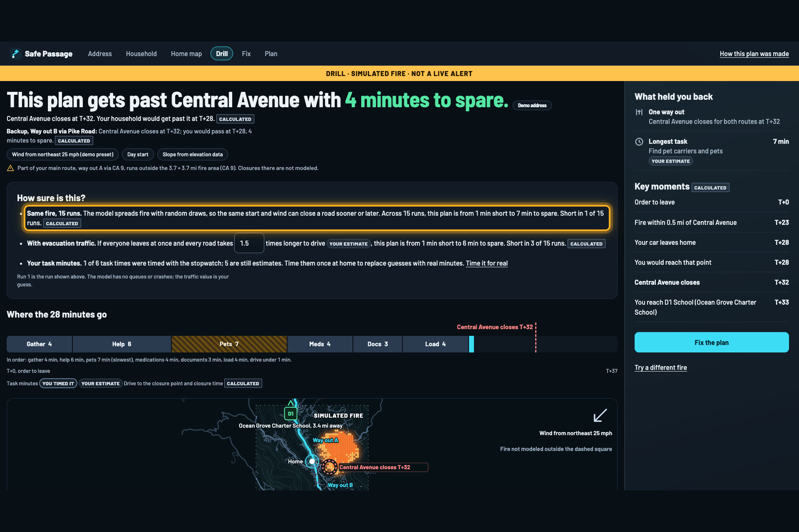

# Safe Passage

**Practice a wildfire where you live and work.** Safe Passage runs a practice wildfire around an address you choose (your home, your workplace, your kids' school) and checks whether your household gets out before the fire closes the road. Then it helps you fix the plan and test it again on the same fire.

**▶ Demo video (2:59):** https://youtu.be/9VEp9KaGHhE

> **Practice drill, not a live alert.** This is a simplified model for practice only, not for real emergency decisions. In a real fire, follow official alerts and local evacuation orders.



## The problem

When the order to leave comes, most of the lost time is spent at home: finding the pets, the medications and the chargers, and helping someone to the car. Then the question is whether the road out is still open. Fire apps show where a fire is right now; very few let a household rehearse before one starts.

## What it does

1. **Address.** Type an address, or press **Try demo address** (Boulder Creek Library, CA, a public building).
2. **Household.** Who is leaving and the tasks before the car can go, each with minutes you can change.
3. **Time it for real.** A stopwatch walks you through the tasks and saves what each one really took.
4. **Home map.** Real roads and two ways out to candidate destinations. It says when both ways out start on the same road.
5. **Drill.** Pick one of up to three suggested fires (scored by wind and uphill slope) or your own point. A grid fire spreads and closes roads.
6. **Results.** The minute the road closes against the minute your household gets past it, and what held you back.
7. **How sure is this?** The same fire run 15 times with other random draws, and the same runs with evacuation traffic.
8. **Other situations, same fire.** Harder days picked by AI (one adult away, a late order, a blocked route...) or typed in your own words.
9. **Fix.** Change the plan and rerun **the same fire**, so an improvement never comes from an easier fire.
10. **Plan.** A printable leaving plan: routes, meeting spot, go-bag list, and what to do if the day goes differently.

Every time and result is tagged **Calculated**, **Your estimate** or **You timed it**; text written by AI is tagged **AI-written**. The AI never calculates a time.

## Run it

Needs **Node.js 24** (the server runs TypeScript directly).

```bash
cd app
npm install
npm run dev:all
```

Open http://localhost:5173 and press **Try demo address**. The demo works without any keys and without network access to the map services (it uses the saved area in `app/server/demo-area.json`).

Optional keys go in `app/.env`:

- `MODEL_API_KEY`: Meta Model API key. It is used for AI situation picks, reading a typed situation, and plan wording. Without it, fixed rules and a fixed checklist are used, and the screen says so.
- `FIRMS_MAP_KEY`: free NASA FIRMS key for the optional "Real fires nearby" reference layer (US only, never part of the drill).

Tests: `cd app && npx vitest run` (351 tests). Production build, Docker and the other options are in [app/README.md](app/README.md).

## How it works

- **Routing:** our own road graph from OpenStreetMap with shortest-time search (Dijkstra). No routing API key is needed.
- **Fire model:** a simplified cellular automaton on 100 m cells around the address. Spread depends on wind and slope, with random draws from a seed, so the same fire can be rerun exactly. A road closes when the fire reaches a cell within 100 m of it. The sea never burns.
- **Range:** the drill's own run plus 14 more seeds give the "How sure is this?" range. Evacuation traffic multiplies every drive time by a factor you can change (1.5 by default).
- **AI with a narrow job:** Meta Model API (`muse-spark-1.3`) picks harder situations, turns a typed situation into the drill's own levers (shown as starting values you can change), and words the plan. Every leave time, drive time, closing minute and margin is calculated by the engine. The AI never gets the home address or coordinates.

Code layout: `app/src/engine/` (fire, roads, routing, drill, ranges), `app/server/` (data sources, caching, AI calls), `app/src/screens/` and `app/src/ui/` (the app). Design mockups, wireframes and mockup screenshots (with sample numbers) are in `design/`; screenshots of the working app are in `docs/`.

## Testing and iteration

| What we found | What changed |
|---|---|
| Early concept mockups could be read as a live alert | A "Drill · simulated fire · not a live alert" band on every drill screen; no "Leave now", no alert levels |
| At Malibu the fire burned across the ocean | Sea cells never burn; no fire can start on the sea |
| The plan said "If X is closed, take X" when both routes share the road | The engine checks whether a closure blocks the backup too |
| A cold load took 60 to 80 s; one address failed after 141 s | One combined query, retries, a backup server, real progress, a clear failure within about 2 minutes |
| One run's "4 minutes to spare" looked exact | 15 runs of the same fire, evacuation traffic, and timed tasks |

Real addresses tested: public buildings in Paradise, Malibu and Big Sur (California) and Katoomba (Australia).

## Limits

- The fire uses wind and slope only: no fuel, humidity or embers. It is not a forecast.
- The base drill assumes the order to leave comes when the fire starts. A late order is tested as one of the harder days.
- Evacuation traffic is a single slowdown factor, not a traffic model.
- Destinations are candidate destinations from OpenStreetMap, not confirmed shelters.
- Only the sea is treated as ground that cannot burn; lakes and rivers are not detected yet.

## Credits

- **Data:** © OpenStreetMap contributors (ODbL), through Overpass and Nominatim; US Census Bureau geocoder; Open-Meteo forecast and elevation (CC BY 4.0); USGS elevation and the US National Weather Service (US fallbacks); NIFC WFIGS fire perimeters and NASA FIRMS satellite detections (optional reference layer only).
- **AI:** Meta Model API, `muse-spark-1.3`.
- **Libraries:** React, Vite, TypeScript, d3-contour, Vitest, oxlint.
- **Font:** Barlow by Jeremy Tribby (SIL Open Font License 1.1).
- **Development tools:** built with help from Claude Code (Anthropic's AI coding assistant) for writing code, tests and review. The demo narration voice is Kokoro TTS (`af_heart`); the video was assembled with HyperFrames.

## Team

Solo project by [@handue](https://github.com/handue): product, design, code, testing and the demo video.
